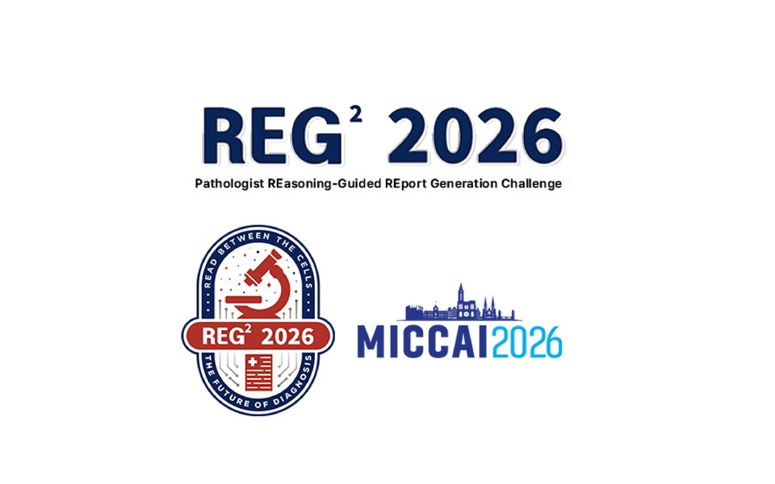

{: style="max-width: 420px; border: 1px solid var(--pub-card-border); border-radius: 10px;"}

**MICCAI 2026 · Abu Dhabi · October 4–8, 2026**

I contribute to the **Pathologist REasoning-Guided REport Generation Challenge (REG² 2026)**, an international challenge organized within the MICCAI 2026 framework, with the Schüffler Lab at the Institute of Pathology, Technical University of Munich (TUM), contributing to its organization and scientific development.

### About the challenge

REG² 2026 moves computational pathology beyond report generation toward **reasoning-guided analysis of whole-slide images (WSIs)**. Building on REG2025, participants must not only generate pathology reports from H&E-stained whole-slide images but also provide a transparent, clinically grounded justification for their findings, aligned with how pathologists actually reach a diagnosis.

### My contribution

My work in the challenge focuses on:

- pathology **data collection and curation**;
- **quality control** of slides and reports;
- **report generation with large language models (LLMs)**;
- **reasoning-based evaluation** of the generated reports;
- **reviewing papers** submitted by participating teams.

### Timeline

- **April 15, 2026:** registration opened
- **May 11, 2026:** training data released
- **June–July 2026:** testing phases
- **MICCAI 2026:** results; the top 3 teams were announced at the conference, and the top 5 teams received certificates

### Links

- [REG² 2026 challenge website](https://reg2026.grand-challenge.org/)
- [TUM Institute of Pathology announcement (May 19, 2026)](https://www.pm.mh.tum.de/en/path/translate-to-english-news-detail/article/reg2026-challenge-on-reasoning-guided-pathology-ai-is-now-open/)
