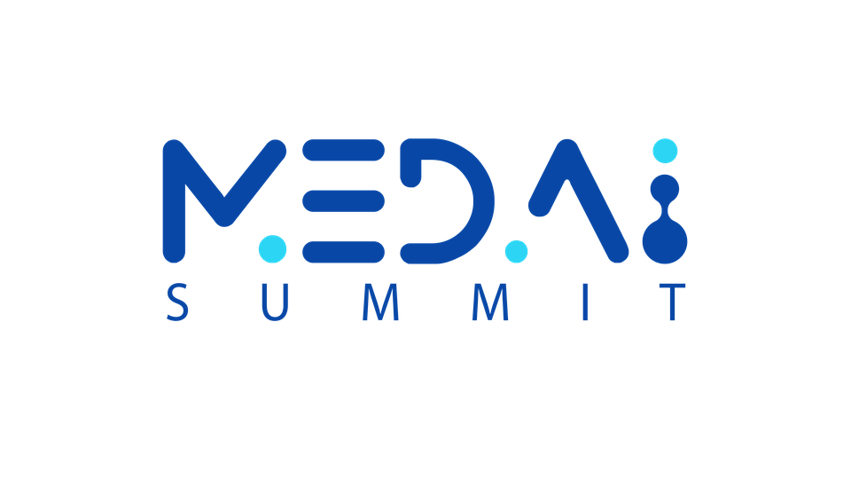

{: style="max-width: 420px; border: 1px solid var(--pub-card-border); border-radius: 10px;"}

I was invited as a **key speaker** on Day 1 of the [2nd MedAI Summit](https://medaisummit.org/en/speakers/dr-azar-kazemi), the international summit on artificial intelligence in healthcare.

**Session:** October 28, 2026, 10:30–11:10 (GMT) · Online

### About the talk

**High performance is a starting point, not the endpoint.** Pathology foundation models now reach impressive accuracy, but clinical trust requires more: generalizability, awareness of uncertainty, and evidence of clinical utility. The talk followed that path in five steps.

**1. The hidden challenge: inter-observer variability.** I started from our study of tumor-infiltrating lymphocytes (TILs) in colorectal cancer, where pathologists assigned different TIL scores to the same slides. This raises two questions: could AI make diagnostic assessments more consistent, and is a high-performing model ready for clinical use? Will it work in another hospital? What happens when the case is ambiguous? Does it actually help the pathologist make a decision?

**2. Foundation models and an expanding landscape.** Instead of training a task-specific encoder for every problem, foundation models pretrained on large, diverse pathology collections turn tissue images into reusable representations that transfer to many downstream tasks.

**3. Is the model learning biology or the hospital?** Recent robustness benchmarks show that foundation-model representations encode both biology and hospital-specific signals. Models with similar accuracy can differ in robustness to medical-center effects, hospital-label bias in training data can reduce performance on unseen hospitals, and reducing site-specific signatures can improve generalization to new settings.

**4. Case study: Barrett's esophagus.** Barrett's esophagus is a demanding test for diagnostic AI: a precursor of esophageal adenocarcinoma with a full progression spectrum, heterogeneous subtypes and known inter-observer variability. In our [npj Digital Medicine study](https://doi.org/10.1038/s41746-026-03329-3) (3,528 H&E whole-slide images from 790 patients, 21 centers in Germany, over 10 years), we benchmarked foundation models for morphological subtyping and cancer detection. What we learned:

- foundation models showed potential for slide-level classification;
- the choice of foundation model influenced performance, and ensembling gave a non-uniform gain;
- performance varied across diagnostic classes;
- pathologists' assessment of attention maps provided additional evidence that the models focus on diagnostically relevant regions;
- independent external validation and clinical evaluation remain essential.

**5. Uncertainty and clinical workflow.** A confident prediction can still be wrong. Uncertainty estimation may help identify predictions that need further review, and foundation models may support more efficient workflows, for example by triaging cases to reduce pathologists' workload while keeping diagnostic performance comparable.

### Take-home message

Accuracy is where clinical AI starts, not where it ends. Trustworthy computational pathology needs models that generalize across hospitals, know when they are uncertain, and demonstrably help pathologists in real clinical workflows.

### Links

- [Speaker page at MedAI Summit 2026](https://medaisummit.org/en/speakers/dr-azar-kazemi)
- [Paper: Barrett's esophagus study, npj Digital Medicine (2026)](https://doi.org/10.1038/s41746-026-03329-3)
- [Paper: TILs and tumor–stroma ratio inter-observer study, Diagnostics (2023)](https://doi.org/10.3390/diagnostics13142339)
- [MedAI Summit on YouTube](https://www.youtube.com/@medaisummit)
